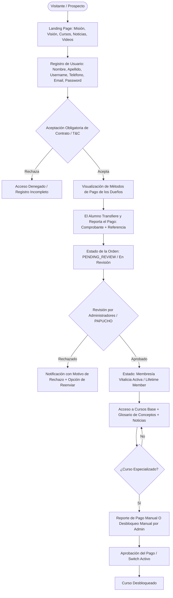

# Product Definition Document (PDD) — Profitivo

---

## 1. Visión General del Producto

### 1.1 Nombre del Producto
**Profitivo**

### 1.2 Declaración de Misión y Visión
- **Misión:** Proporcionar educación directa, práctica y sin rodeos en el ecosistema cripto, tecnológico, visual y UX/UI, permitiendo a los estudiantes adquirir habilidades de alta demanda y monetizables con profesionalismo.
- **Visión:** Convertirse en el hub educativo de referencia en habla hispana para creadores, inversores y tecnólogos digitales que buscan contenido conciso, actualizado y de alto impacto estético y operativo.

### 1.3 Identidad de Marca y Sistema Visual UX/UI (Basado en el Logo Oficial)

- **Nombre Oficial:** **PROFITIVO**
- **Slogan / Tagline Oficial:** *"TAKING YOU UPWARDS | TRADING SOLUTIONS"*
- **Simbología del Logotipo:**
  - Monograma "P" geométrico 3D atravesado por un vector/flecha alcista en dirección ascendente (*uptrend / bullish*), simbolizando crecimiento financiero y escalamiento de conocimiento.
  - Enmarcado en un medallón circular con borde de neón esmeralda y detalles en oro.
- **Paleta Cromática Oficial:**
  - **Fondo Primario (*Dark Midnight*):** `#060B14` y `#0B1322` (profundidad de plataforma de trading profesional).
  - **Color Acento Alcista (*Neon Emerald*):** `#00E676` y `#10B981` (representa ganancias, velas alcistas, éxito y tecnología).
  - **Color Acento Secundario (*Prestige Gold*):** `#F59E0B` y `#EAB308` (resplandor dorado presente en el logotipo, comunica exclusividad y seriedad).
  - **Superficies y Tarjetas (*Glassmorphism Tech*):** `#101D33` con bordes sutiles `rgba(16, 185, 129, 0.2)` y sombras difusas (*glow*).
  - **Tipografía:**
    - Títulos y Números: **Plus Jakarta Sans** / **Outfit** (geométrica, moderna, seria y de alto impacto).
    - Textos de lectura: **Inter** / **Geist** (legibilidad técnica y cristalina).
- **Texturas y Elementos de Interfaz:**
  - Patrón sutil de cuadrícula de análisis técnico y siluetas tenues de velas japonesas (*candlesticks*) en el fondo.
  - Microinteracciones limpias, sin saturación: botones con gradientes esmeralda-dorado, tarjetas con reflejo de luz suave.

---

## 2. Reglas de Negocio (Business Rules)

### RN-01: Proceso de Onboarding y Registro
1. **Datos requeridos del alumno:** Nombre, apellido, nombre de usuario (*username* único), número de teléfono, correo electrónico verificado y contraseña cifrada.
2. **Aceptación de Contrato (Términos, Condiciones y Políticas de Privacidad):**
   - La aceptación es **estrictamente obligatoria** antes de poder ver las instrucciones de pago o acceder a la plataforma.
   - El sistema registra de manera inmutable: identificador de usuario, versión del contrato aceptado, dirección IP y marca temporal (*timestamp ISO-8601*).
   - **Cláusulas Oficiales del Contrato:**
     > *"Al adquirir, acceder o utilizar los cursos y contenidos de Profitivo, aceptas de forma implícita e incondicional los siguientes puntos:*
     > 
     > *1. Carácter 100% Educativo: Todo el material (clases, videos, guías, análisis y explicaciones) tiene un propósito estrictamente académico e informativo. Profitivo ni sus instructores prestan asesoramiento financiero, recomendaciones de inversión, gestión de capital ni servicios de corretaje (brokerage).*
     > 
     > *2. Advertencia de Riesgo Financiero: El comercio en mercados financieros (forex, criptomonedas, acciones, futuros, etc.) implica un alto riesgo de pérdida de capital. Los rendimientos pasados, análisis o ejemplos prácticos no garantizan ni aseguran resultados futuros. Eres el único y absoluto responsable de las decisiones operativas y financieras que tomes en tu cuenta personal.*
     > 
     > *3. Propiedad Intelectual y Licencia Personal: Al comprar el curso adquieres una licencia personal, individual e intransferible. Queda estrictamente prohibida la reventa, reproducción, distribución, transmisión o difusión del contenido en plataformas de terceros o grupos (Telegram, Discord, WhatsApp, etc.). La violación de esta norma derivará en la cancelación inmediata del acceso sin derecho a reembolso y posibles acciones legales.*
     > 
     > *4. Política de Pagos y Reembolsos: El acceso al curso digital se otorga de forma inmediata tras el pago. Debido a la naturaleza del contenido digital de consumo instantáneo, no se realizan devoluciones ni reembolsos una vez otorgado el acceso a la plataforma.*
     > 
     > *5. Limitación de Responsabilidad: La academia Profitivo queda eximida de cualquier responsabilidad por pérdidas económicas, daños directos o indirectos derivados del uso o aplicación de las estrategias, conocimientos o herramientas enseñadas dentro de la academia."*

### RN-02: Modelo de Monetización Manual con Aprobación Administrativa
1. **Configuración de Métodos de Pago por los Administradores:**
   - Los 2 administradores dueños (y PAPUCHO como Shadow Admin) definen y gestionan los métodos de pago disponibles en el portal (transferencias bancarias, billeteras cripto USDT TRC20/BEP20, Binance Pay ID, PayPal, Pago Móvil, etc.).
   - Cada método incluye: Título, datos de cuenta/wallet, titular, instrucciones y código QR.
2. **Membresía Vitalicia Única (*Permanent Lifetime Membership*):**
   - Una vez registrado y aceptado el contrato, el usuario visualiza los métodos de pago.
   - Realiza la transferencia y completa el **Reporte de Pago** (método utilizado, referencia o txHash, comprobante en imagen/PDF y notas).
   - **Estado En Revisión (*Pending Review*):** El usuario permanece en una pantalla informativa de espera hasta que los administradores revisen y aprueben el comprobante.
   - **Aprobación:** Desbloquea de forma permanente el acceso a la plataforma, noticias, videos informativos y todos los **Cursos Base**.
3. **Cursos Desbloqueables por Pago Individual (*Pay-per-Course*) y Control Manual:**
   - Cursos avanzados con candado que requieren pago individual o **desbloqueo manual directo** por parte de los administradores.
   - Tras reportar el pago respectivo y ser aprobado (o activado manualmente por el admin), el curso queda permanentemente desbloqueado en el perfil del alumno.

### RN-03: Perfil del Usuario y Autoservicio
- El alumno puede actualizar en cualquier momento sus datos personales desde la sección "Mi Perfil":
  - Nombre y Apellido.
  - Nombre de Usuario (*Username*).
  - Número de Teléfono.
  - Cambio de Contraseña (ingresando su contraseña actual para validar identidad).
- Permisos de contenido: Modo *Viewer-Only* para lecciones y glosarios, sin descargas directas.

### RN-04: Recuperación Asistida de Cuenta (Usuario y Contraseña)
- **Botón de Asistencia en Login:** Si el usuario olvida su contraseña o su nombre de usuario, dispone de un botón directo: *"¿Olvidaste tus datos? Solicitar recuperación a los administradores"*.
- **Petición de Ayuda:** El usuario ingresa su correo o teléfono de contacto y un mensaje explicativo.
- **Acción Administrativa:**
  - Los administradores visualizan la solicitud en su panel.
  - Tienen la facultad de consultar el nombre de usuario registrado.
  - Tienen la facultad de **restablecer la contraseña del usuario** (asignando una contraseña temporal segura o forzando el cambio en el próximo inicio de sesión) o actualizar su nombre de usuario si este lo extravió.

### RN-05: Gobernanza y Capacidades Administrativas

#### A. Los 2 Administradores Visibles (Dueños / Fundadores):
1. **Gestión de Cursos, Videos y Glosario:**
   - Cargar y editar cursos, módulos y lecciones de video.
   - **Glosario y Definiciones del Curso:** Cargar conceptos clave, palabras técnicas y definiciones asociadas al contenido de cada curso para consulta rápida del estudiante.
2. **Ventana de Gestión Integral de Usuarios:**
   - Directorio completo de usuarios registrados.
   - **Datos visibles:** Nombre, apellido, nombre de usuario, correo electrónico, número de teléfono, estado de cuenta.
   - **Seguridad estricta:** **Las contraseñas NUNCA son visibles** (están protegidas mediante hashing criptográfico irreversible `Argon2id`).
   - **Trazabilidad Legal:** Visualización de la fecha y hora exacta en la que el usuario aceptó el contrato/términos, junto a su IP.
   - **Historial de Pagos:** Detalle cronológico de cuándo pagó, qué concepto pagó (membresía o curso específico), monto, método de pago utilizado, número de referencia y visualización del comprobante.
   - **Control Granular de Acceso (*Toggle Switch*):** Capacidad de **bloquear o desbloquear cualquier curso en específico** para un usuario determinado con un solo clic.
   - **Restablecimiento de Credenciales:** Módulo para modificar el nombre de usuario o restablecer la contraseña de alumnos que hayan solicitado asistencia.

#### B. Shadow Super-Admin (PAPUCHO):
- **Completamente invisible:** No aparece en el directorio de usuarios, ni en créditos de la academia, ni en las listas administrativas de los 2 dueños.
- **Control Supremo (*God Mode*):** Todas las capacidades de los administradores dueños, más acceso a la estructura de la base de datos, auditoría silenciosa y anulación de cualquier bloqueo o permiso.

---

## 3. Arquitectura Funcional del Portal

### 3.1 Portal Público y Dashboard de Entrada (Vista Inicial)
Cuando el usuario entra a la web, la primera pantalla despliega de forma impactante y limpia:
- **Header & Hero con Logo de Profitivo:** Identidad visual moderna, tecnológica y profesional con tipografía cripto/fintech.
- **Bloque "¿Qué es Profitivo?":** Explicación clara de la plataforma como academia formativa directa, práctica y sin relleno.
- **Bloque Misión y Visión:** Tarjetas visuales que transmiten los valores, el propósito y el horizonte de la academia.
- **Bloque de Propuesta Educativa ("Cursos que Enriquecen tu Conocimiento"):** Destaca cómo la formación en criptomonedas, tecnología, finanzas digitales y diseño UI/UX empodera a los usuarios con habilidades prácticas y rentables.
- **Preview del Catálogo de Cursos:** Tarjetas con las formaciones disponibles, temarios y badges informativos.
- **Noticias, Videos y Acceso Rápido:** Acceso directo para registrarse, iniciar sesión o solicitar asistencia.

### 3.2 Portal Privado del Estudiante
- **Pantalla de Espera (En Revisión):** Visualización de estado si su pago aún no ha sido aprobado.
- **Dashboard de Aprendizaje:**
  - Mis Cursos Base desbloqueados.
  - Catálogo de cursos especializados (con candado o botón de reporte de pago).
  - **Sección de Glosario del Curso:** Pestaña o modal interactivo con términos, definiciones y conceptos clave explicados al grano.
  - Reproductor de video profesional optimizado con control de velocidad y memoria de avance.
- **Mi Perfil:** Formulario de edición de nombre, apellido, usuario, teléfono y cambio de contraseña.
- **Historial de Pagos:** Estado de cada comprobante reportado (`EN REVISIÓN`, `APROBADO`, `RECHAZADO`).

### 3.3 Backoffice de Administradores (Dueños y PAPUCHO)
- **Directorio de Usuarios:**
  - Tabla interactiva con búsqueda por nombre, email, usuario o teléfono.
  - Ficha detallada de usuario con fecha de aceptación de contrato, historial de pagos y métodos usados.
  - Matriz de cursos con interruptores de activación/desactivación manual inmediata.
  - Botón de acción: *"Restablecer Contraseña"* y *"Editar Nombre de Usuario"*.
- **Bandeja de Aprobación de Pagos:** Revisión de comprobantes de membresía y cursos con botones de *Aprobar* y *Rechazar*.
- **Gestor de Contenido y Cursos:** Subida de videos, estructuración de módulos y carga de glosarios/definiciones asociadas.
- **Gestor de Métodos de Pago:** Configuración de wallets crypto, cuentas bancarias y QRs.
- **Bandeja de Solicitudes de Recuperación:** Cola de usuarios que han solicitado restablecimiento de usuario o contraseña.

---

## 4. Requerimientos del Sistema

### 4.1 Requerimientos Funcionales (RF)
- **RF-01:** Registro completo con campos: nombre, apellido, username, teléfono, email, contraseña.
- **RF-02:** Aceptación obligatoria del contrato legal con auditoría (fecha, hora, IP, versión).
- **RF-03:** Módulo de glosario y términos técnicos asociado a cada curso.
- **RF-04:** Directorio administrativo de usuarios con historial de pagos, fecha de contrato y sin exposición de contraseñas.
- **RF-05:** Conmutador manual (*toggle*) para bloquear o desbloquear cursos específicos por alumno.
- **RF-06:** Autoservicio de perfil de usuario (nombre, apellido, username, teléfono, password).
- **RF-07:** Flujo asistido de recuperación de credenciales y restablecimiento directo por los administradores.
- **RF-08:** Módulo de métodos de pago manuales y bandeja de aprobación de comprobantes.

### 4.2 Requerimientos No Funcionales (RNF)
- **RNF-01 (Seguridad Criptográfica):** Almacenamiento de contraseñas exclusivamente en hashes irreversibles (`Argon2id`). Prohibido terminantemente guardar o mostrar contraseñas en texto plano.
- **RNF-02 (Privacidad del Shadow Admin):** Invisibilidad absoluta de **PAPUCHO** en cualquier listado o consulta del backoffice de los 2 dueños.
- **RNF-03 (Compresión Inteligente de Imágenes sin Pérdida):**
  - Todo archivo o imagen subido por alumnos (comprobantes de pago, avatar) o administradores (portadas de cursos, QR de cobro, fotos de noticias) debe comprimirse automáticamente al máximo posible mediante conversión a formato **WebP** de alta eficiencia.
  - La compresión reduce el peso hasta un 85-90% preservando total nitidez y legibilidad (crucial para números de referencia y montos en comprobantes bancarios).
  - La compresión se realiza preferentemente en el cliente previo al envío para garantizar cargas ultrarrápidas y mínimo consumo de storage.
- **RNF-04 (Protección de Video):** Tokens HLS de video de corta duración para evitar enlaces públicos o descargas.
