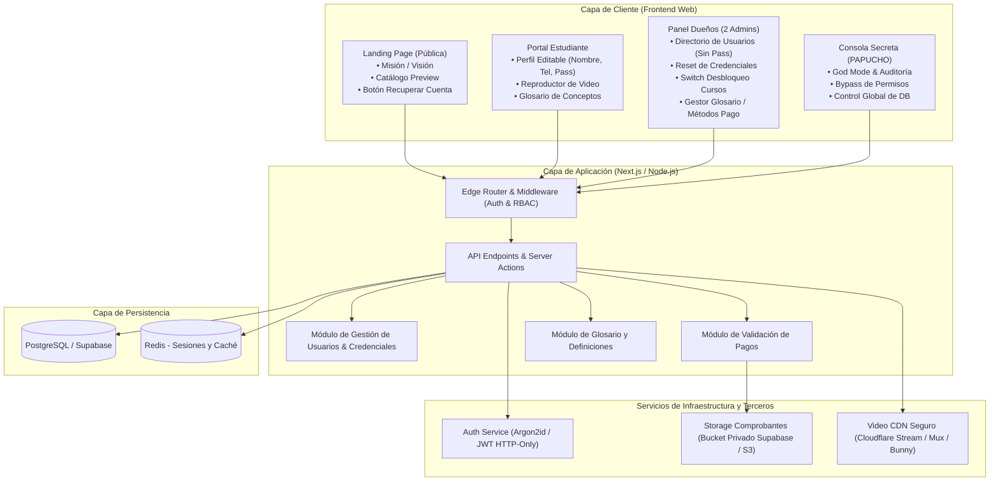
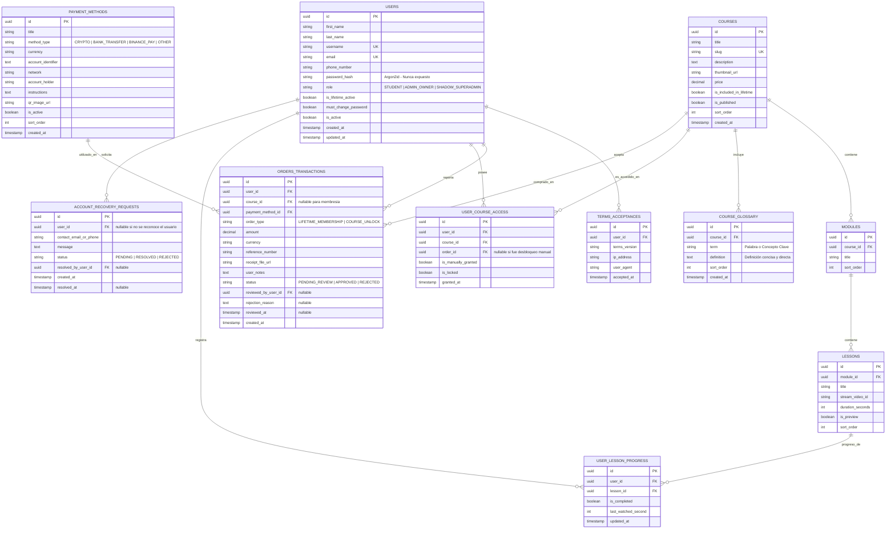
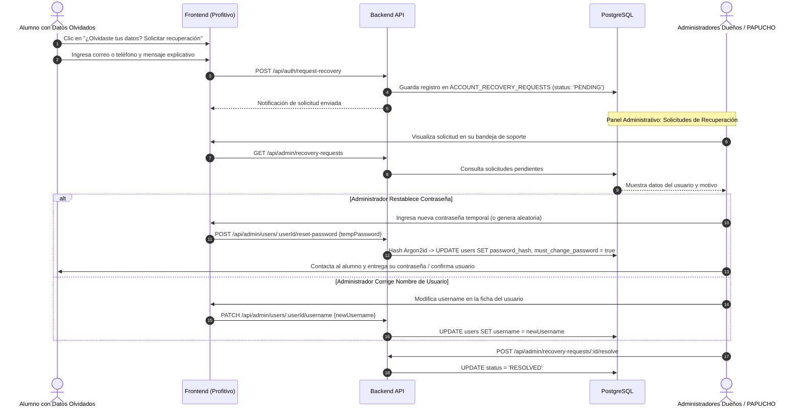

# Software Design Document (SDD) — Profitivo

---

## 1. Arquitectura del Sistema

### 1.1 Diagrama de Arquitectura Global



### 1.2 Stack Tecnológico Recomendado
- **Frontend / Backend:** **Next.js 14+ (App Router)** o React/Vite optimizado para **Cloudflare Pages**.
- **Estilos e Interfaz:** **Tailwind CSS + Lucide Icons + Shadcn/ui**, paleta *dark modern crypto/tech* (fondo `#0a0b0d`, acentos verde neón/cian eléctrico, tipografía técnica, diseño responsivo).
- **Base de Datos:** **PostgreSQL (Supabase)** en la nube con API y Auth integrado.
- **Almacenamiento de Comprobantes & Assets:** **Supabase Storage** con bucket privado y URLs firmadas.
- **Pipeline de Compresión de Imágenes:** Módulo cliente/servidor con conversión forzosa a formato **WebP** progresivo (calidad 80-85%) y redimensionamiento proporcional. Reduce fotos de 5-10 MB a ~150-250 KB sin degradar la nitidez de letras ni números de comprobantes bancarios.
- **Alojamiento y Protección de Video:** **Bunny.net Stream** o **Cloudflare Stream** (reproducción protegida anti-descargas).
- **Despliegue & CDN:** **Cloudflare Pages** (dominio gratuito `profitivo.pages.dev`, SSL automático, CDN global de baja latencia y protección DDoS).

### 1.3 Estrategia de Despliegue en Cloudflare Pages (`profitivo.pages.dev`)
1. **Hosting en Cloudflare Pages:**
   - La aplicación se conecta directamente desde el repositorio de Git (GitHub/GitLab).
   - En cada push a la rama `main`, Cloudflare compila y despliega en cuestión de segundos.
   - Provee el subdominio directo `https://profitivo.pages.dev` (al estilo de `nailsapp.pages.dev` o `srpapa.pages.dev`).
2. **Soporte PWA (Progressive Web App):**
   - La web incluye `manifest.json` y Service Worker para que los usuarios puedan pulsar **"Instalar App"** en su navegador móvil (Android / iOS) y tener Profitivo en su pantalla de inicio como una aplicación nativa.

---

## 2. Modelo de Datos y Esquema Relacional (ERD)



---

## 3. Matriz de Roles y Reglas de Seguridad (RBAC & Shadow Admin)

### 3.1 Niveles de Acceso y Visibilidad

| Funcionalidad / Módulo | Estudiante (`STUDENT`) | Administradores Dueños (`ADMIN_OWNER`) | Shadow Super-Admin (`SHADOW_SUPERADMIN` - PAPUCHO) |
| :--- | :---: | :---: | :---: |
| **Ver / Editar Perfil Propio (Nombre, Apellido, Username, Tel, Pass)** | ✅ Sí | ✅ Sí | ✅ Sí |
| **Ver Directorio de Usuarios** | ❌ No | ✅ Sí (Datos completos, **sin contraseñas**) | ✅ Sí (Control absoluto y vista total) |
| **Ver Fecha de Aceptación de Contrato e IP** | ❌ No | ✅ Sí | ✅ Sí |
| **Ver Historial de Pagos y Métodos Usados** | Solo los suyos | ✅ Sí (Todos los alumnos) | ✅ Sí |
| **Bloquear / Desbloquear Cursos a Alumnos (Switch Manual)** | ❌ No | ✅ Sí | ✅ Sí |
| **Restablecer Usuario o Contraseña a Alumnos** | ❌ No | ✅ Sí | ✅ Sí |
| **Cargar Cursos, Videos y Glosario de Conceptos** | ❌ No | ✅ Sí | ✅ Sí |
| **Visibilidad en Listas y Reportes** | Visible a Admins | Visible en Staff | **Completamente Invisible (*Shadow*)** |

### 3.2 Aislamiento Estricto de Contraseñas
Por directiva de arquitectura y seguridad:
- El campo `password_hash` está excluido de todas las proyecciones y serializaciones de la API:
```typescript
// Selector seguro por defecto para el directorio de usuarios
export const safeUserSelect = {
  id: true,
  firstName: true,
  lastName: true,
  username: true,
  email: true,
  phoneNumber: true,
  role: true,
  isLifetimeActive: true,
  createdAt: true,
  termsAcceptances: {
    select: {
      termsVersion: true,
      ipAddress: true,
      acceptedAt: true
    }
  }
}; // password_hash NUNCA se incluye
```

### 3.3 Aislamiento del Shadow Admin (PAPUCHO)
- En todas las consultas ejecutadas por los 2 dueños, el interceptor de base de datos aplica:
  `WHERE role != 'SHADOW_SUPERADMIN'`.
- De este modo, los dueños ven a todos los estudiantes y sus propios perfiles, pero **la existencia de PAPUCHO es indetectable en la interfaz administrativa ordinaria**.

---

## 4. Flujos Clave de Interacción

### 4.1 Restablecimiento Asistido de Credenciales (Usuario / Contraseña)



### 4.2 Conmutador Manual de Bloqueo/Desbloqueo de Cursos (*Toggle*)
En la ficha del alumno dentro del Backoffice:
1. El administrador visualiza la lista de cursos existentes con un interruptor (*toggle*).
2. Si el administrador activa el interruptor de un curso:
   - Se crea o actualiza el registro en `USER_COURSE_ACCESS` con `is_manually_granted = true` y `is_locked = false`.
   - El alumno obtiene acceso inmediato al curso en su dashboard.
3. Si el administrador desactiva el interruptor:
   - Se marca `is_locked = true`.
   - El curso vuelve a mostrar el candado en el portal del alumno.

---

## 5. Especificación de Endpoints Principales (REST API)

### 5.1 Directorio y Gestión de Usuarios (Backoffice)
- `GET /api/admin/users` $\rightarrow$ Lista de todos los usuarios registrados (con nombre, apellido, username, email, teléfono, fecha de aceptación de contrato e IP; **sin contraseñas**).
- `GET /api/admin/users/:id/details` $\rightarrow$ Ficha completa del usuario con historial de compras/pagos (cuándo pagó, concepto, referencia, método de pago y comprobante).
- `POST /api/admin/users/:id/courses/:courseId/toggle` $\rightarrow$ Bloquea o desbloquea manualmente un curso para ese estudiante.
- `POST /api/admin/users/:id/reset-password` $\rightarrow$ Asigna contraseña temporal y activa `must_change_password`.
- `PATCH /api/admin/users/:id/username` $\rightarrow$ Modifica el nombre de usuario de un alumno asistido.

### 5.2 Perfil del Estudiante (Autoservicio)
- `GET /api/user/profile` $\rightarrow$ Obtiene datos de perfil del usuario logueado.
- `PATCH /api/user/profile` $\rightarrow$ Permite al alumno editar: `first_name`, `last_name`, `username`, `phone_number`.
- `POST /api/user/change-password` $\rightarrow$ Cambia contraseña validando la contraseña actual.

### 5.3 Cursos y Glosario de Conceptos
- `GET /api/courses/:id/glossary` $\rightarrow$ Retorna listado de conceptos clave y definiciones del curso.
- `POST /api/admin/courses/:id/glossary` $\rightarrow$ Carga o edición de términos y definiciones del curso por los administradores.
- `POST /api/admin/courses` $\rightarrow$ Carga de nuevos cursos, módulos y videos.

### 5.4 Solicitudes de Recuperación de Cuenta
- `POST /api/auth/request-recovery` $\rightarrow$ Formulario público para solicitar ayuda a los administradores.
- `GET /api/admin/recovery-requests` $\rightarrow$ Bandeja de solicitudes de recuperación para los administradores.
- `POST /api/admin/recovery-requests/:id/resolve` $\rightarrow$ Marca la solicitud como resuelta.
